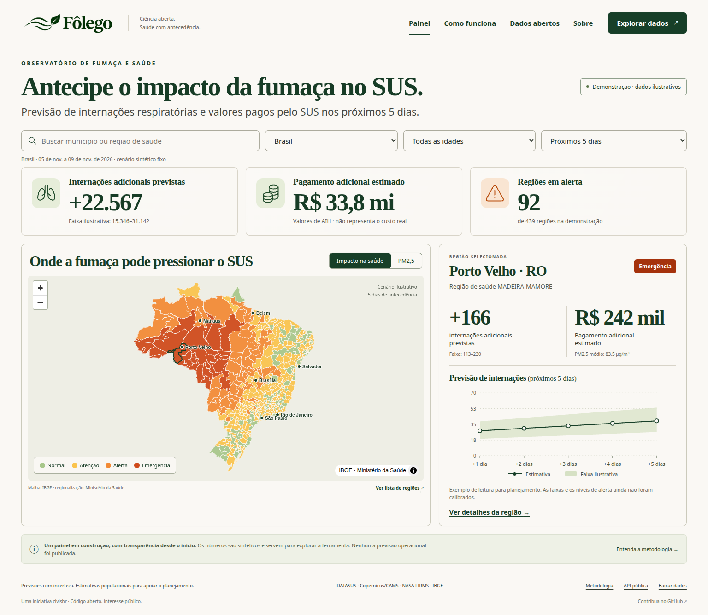

<p align="center">
  
</p>

<p align="center"><strong>Mais antecedência. Mais fôlego para o SUS.</strong><br>Observatório aberto de fumaça de queimadas e saúde.</p>

<p align="center">
  <a href="https://civisbr.github.io/folego/">Painel público</a> ·
  <a href="PROJECT.md">Requisitos</a> ·
  <a href="docs/methodology.md">Metodologia</a> ·
  <a href="docs/validation.md">Validação</a> ·
  <a href="https://github.com/civisbr/folego/actions/workflows/ci.yml"></a>
</p>

O Fôlego está sendo construído para estimar o excesso de internações respiratórias e os valores adicionais pagos pelo SUS após a exposição à fumaça, por região de saúde e faixa etária, com horizonte de 1–5 dias.

**Esta primeira versão é uma demonstração funcional.** O painel contém dados sintéticos explicitamente identificados. A geografia e a correspondência territorial são reais. A implementação estatística é testada com efeitos artificiais conhecidos; não existe ainda um modelo nacional calibrado nem um backtest com dados reais aprovado. Não utilize a demonstração para decisões operacionais.



### O que está implementado

- Painel responsivo seguindo o [design fornecido](docs/design-reference.png), com a identidade visual original, mapa MapLibre, busca nacional, filtros por estado/idade/horizonte, gráfico, detalhes e lista acessível de regiões.
- **5.571 municípios correspondidos (100%) e 439 regiões de saúde**, a partir do IBGE e da API do Ministério da Saúde. Boa Esperança do Norte tem complemento documentado por resolução da SES/MT. [Proveniência e cobertura](web/public/data/manifest.json).
- Python 3.12 + uv, dependências travadas, Ruff, pytest, Makefile, CI e publicação no GitHub Pages.
- Adaptadores para SIH/SUS, CAMS/ADS, ERA5/CDS, NASA FIRMS e snapshot InfoGripe, com cache local. Adaptadores externos autenticados ainda dependem de credenciais e validação de integração.
- Normalização de códigos DATASUS/IBGE, filtros CID e idade SIH, contagem por residência/data, ponderação populacional de exposição e correção por IPCA a partir de índices fornecidos.
- Base cruzada de PM2,5 × lags 0–7, GLM quasi-Poisson, confundidores, excesso contrafactual e faixa da média condicional por simulação conjunta dos coeficientes.
- Executor de previsão de pesquisa sobre painéis preparados, preservando histórico de exposição e atraso de 62 dias para o SIH, além de divisões temporais, métricas semanais e teste de controle negativo.
- Exportação de agregados JSON/Parquet com supressão de contagens menores que 5 e pagamentos associados; arquivos públicos estáticos e CSV do recorte selecionado.

### Primeiro piloto com dados reais

O [piloto Madeira-Mamoré / 2019](docs/pilots/madeira-mamore-2019.md) processou **324 arquivos das 27 UFs**, conferindo **2.677 internações respiratórias por residência** com o TabNet: **diferença de 0% no total e nos 12 meses**. Quarenta e cinco desses atendimentos ocorreram fora de Rondônia. O recorte é por competência de processamento; a série por data de internação ainda precisa de uma janela maior para maturação. Isso valida a primeira ingestão e sua conferência, sem atribuir internações à fumaça ou liberar previsões reais.

```sh
uv run --extra sih folego pilot --require-tabnet \
  --publish-report docs/pilots/madeira-mamore-2019.md
```

Os arquivos brutos e as células diárias ficam fora do Git. O relatório publica apenas totais amplos, a consulta de referência e a proveniência dos arquivos oficiais.

### Executar localmente

Pré-requisitos: [uv](https://docs.astral.sh/uv/), Python 3.12, Node.js 22.12 ou superior e Make.

```sh
git clone https://github.com/civisbr/folego.git
cd folego
make setup
make check
make serve
```

Abra a URL impressa pelo Vite. Os arquivos públicos já estão versionados; explorar a demonstração não exige credenciais, ingestão nem download de microdados.

```sh
# Testes científicos e de transformação
make test

# Navegação e acessibilidade em desktop e celular
cd web
npx playwright install chromium
npm test
```

### Dados e pipeline

```sh
# Baixar/atualizar a correspondência oficial (cache em data/raw/territory)
uv run folego territory --refresh

# Regerar malha agregada e dados exclusivamente sintéticos do painel
uv run folego geography
make demo

# Uma competência SIH; requer a dependência opcional de DBC
uv sync --extra sih
uv run folego sih --state RO --year 2023 --month 9

# CAMS: solicitação JSON exportada da interface oficial do ADS
uv sync --extra climate
uv run folego cams \
  --dataset cams-global-atmospheric-composition-forecasts \
  --request requests/cams.json

# Previsão de pesquisa; os painéis de entrada precisam ser preparados e auditados
uv run folego forecast --history data/staging/history.parquet \
  --future data/staging/future.parquet --issued-on 2026-11-04
```

`requests/cams.json` no exemplo é um arquivo que você cria exportando a requisição do ADS; não é um arquivo de credenciais nem um dado distribuído no repositório. Leia o [guia operacional](docs/operations.md) para contratos de entrada, credenciais, cache, limites e automação.

```text
folego/
  ingest/        SIH, FIRMS, CAMS, ERA5, IBGE e InfoGripe
  transform/     códigos, desfechos e exposição
  models/        cross-basis, GLM, contrafactual e previsão
  evaluate/      origem móvel, métricas e controle negativo
  publish/       exportação segura, malha e demonstração
  resources/     complementos territoriais com fonte
web/             painel estático e arquivos públicos
notebooks/       somente exploração, sem lógica de produção
tests/           testes sintéticos e contratos de dados
data/            raw → staging → marts; fora do Git
```

### Transparência e próximos critérios de aceite

A [matriz de requisitos e validação](docs/validation.md) registra o que foi verificado e o que está pendente. As etapas científicas restantes incluem ingestão SIH nacional desde 2012, comparação TabNet (< 1%), integração geoespacial dos rasters de PM2,5/população, ajuste e diagnóstico por região, validação com origens móveis 2019–2024 e sensibilidade a MERRA-2. O cron diário audita a territorialização; só executa a previsão de pesquisa se URLs de painéis preparados forem configuradas. Não publica previsões sintéticas como atualizações reais.

O PM2,5 total do CAMS não isola, por si só, a contribuição das queimadas. A atribuição específica à fumaça exige uma definição adicional de exposição e análise de sensibilidade. Associação ecológica não é diagnóstico individual nem substitui a vigilância oficial. **AIH é valor pago pelo SUS, não custo real hospitalar.**

### Contribuir e licenças

Veja [CONTRIBUTING.md](CONTRIBUTING.md). Código e identificadores em inglês; documentação e interface em português. Os commits seguem os prefixos `feat:`, `fix:`, `test:`, `docs:` e `chore:`, com descrição imperativa em inglês, conforme a convenção recente do civisbr/brasilverso.

Código: [MIT](LICENSE). Dados derivados: [CC BY 4.0](DATA-LICENSE.md), respeitando as fontes originais. Atribuição: DATASUS/Ministério da Saúde, Copernicus/CAMS, NASA FIRMS e IBGE. O logo e o design fornecidos são preservados nos arquivos do projeto.
